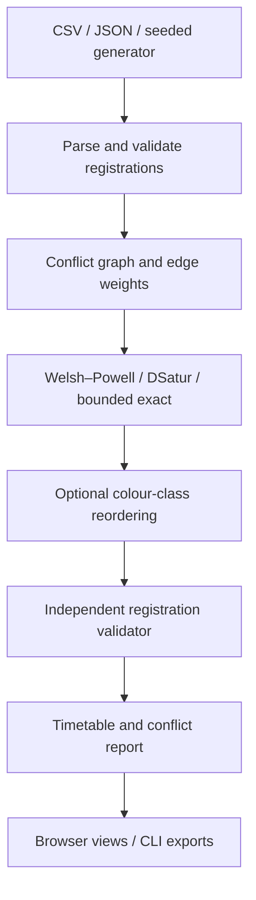

# ExamCraft: University Exam & Timetable Scheduler

## Discrete Mathematics Course Project

| Field | Details |
| --- | --- |
| Institution | Vishwakarma Institute of Technology, Pune |
| Programme | B.Tech., Computer Engineering |
| Course | Discrete Mathematics |
| Student | Prasanna Mahalpure |
| Additional team members | **[Enter names and roll numbers before submission]** |
| Division / batch | **[Enter division and batch]** |
| Guide / instructor | **[Enter instructor name]** |
| Academic year | 2026–2027 |

## 1. Abstract

ExamCraft constructs a university examination timetable from course registrations using graph colouring. Each course is a vertex, and two courses are connected when at least one student takes both. Assigning different colours to adjacent vertices therefore creates an examination timetable with no simultaneous examinations for any student. A colour corresponds to a time slot and may contain several mutually compatible examinations.

The project implements the Welsh–Powell and DSatur heuristics, compares their schedules, and provides a bounded exact search for small instances. An independent validator checks the resulting assignment directly against the original student registrations. A second optimisation stage reorders whole colour classes to reduce the number of students' consecutive examination pairs within a day while preserving the number of slots and all hard constraints.

Two usable interfaces are provided: a standard-library Python package with command-line tools and a browser application with an interactive conflict graph, timetable, algorithm comparison, student lookup, and exports. The implementations are independent; the browser does not require a Python server. Both use documented input formats and deterministic tie-breaking. The project explicitly distinguishes a valid schedule, a good heuristic schedule, and a mathematically certified minimum.

**Keywords:** graph colouring, chromatic number, independent sets, Welsh–Powell, DSatur, conflict graph, exam timetabling, combinatorial optimisation.

## 2. Problem statement and scope

Given students and their registered courses, assign exactly one examination slot to every course so that no student has two examinations in the same slot. Use as few slots as practical and, where possible, reduce back-to-back examinations on the same day.

### 2.1 Hard constraints

1. Every course in the dataset receives exactly one slot.
2. Every assigned slot is a valid, nonnegative integer internally.
3. A student never has more than one registered course in a slot.
4. Registration and course identifiers are validated before scheduling.

### 2.2 Objectives in priority order

1. Satisfy all hard constraints.
2. Minimise the number of occupied slots.
3. Improve the within-day consecutive-examination penalty without increasing the slot count.

A heuristic result is an upper bound on the minimum. The interface must not describe every heuristic result as the chromatic number.

### 2.3 Deliberate scope boundaries

This is an examination conflict scheduler. It does not allocate rooms or invigilators, enforce seating capacities, model different examination durations, reserve laboratories, handle individual accessibility arrangements, or perform semester-long lecture scheduling. Slot capacity is unlimited under the mathematical model. A university deployment would add these constraints and protect real student data using authenticated storage and institutional policies.

## 3. Mathematical model

Let:

- \(S\) be the set of students;
- \(V\) be the set of distinct course identifiers, including explicitly declared courses with no registrations;
- \(R_s\subseteq V\) be the set of courses registered by student \(s\);
- \(E=\{\{u,v\}:u\ne v,\ \exists s\in S,\ u,v\in R_s\}\).

Then \(G=(V,E)\) is a **simple undirected conflict graph**. It has no self-loops because a course does not conflict with itself, and no parallel edges because adjacency is a yes/no relation.

The weighted form additionally records:

\[
 w(u,v)=|\{s\in S:u,v\in R_s\}|.
\]

An edge of weight 20 and an edge of weight 1 both prohibit simultaneous examinations. Their weights can help explain how many students cause a conflict and can support future fairness objectives.

A schedule using \(k\) slots is a function:

\[
 c:V\longrightarrow\{0,1,\ldots,k-1\}
\]

such that:

\[
 \forall\{u,v\}\in E,\qquad c(u)\ne c(v).
\]

The UI and exported timetable present these as Slot 1 through Slot \(k\). The minimum possible \(k\) is the chromatic number \(\chi(G)\). Each set \(c^{-1}(i)\) is an independent set, so a colouring partitions courses into compatible examination groups.

### 3.1 Correctness theorem: colouring and clash freedom

**Theorem.** An assignment is a proper colouring of the conflict graph if and only if no student has two registered examinations in the same slot, provided every course receives exactly one slot.

**Proof, forward direction.** Suppose \(c\) is a proper colouring but a student has distinct registered courses \(u\) and \(v\) in the same slot. By construction, that student's registration creates edge \(\{u,v\}\). Proper colouring requires \(c(u)\ne c(v)\), contradicting the assumed clash.

**Proof, reverse direction.** Suppose no student has a clash, but some adjacent courses \(u\) and \(v\) share a slot. Their edge exists only because some student registers for both. That student would have two examinations in the same slot, a contradiction. Thus every edge joins differently coloured vertices. ∎

The course-coverage condition matters: omitting an examination can produce zero reported clashes without producing a complete timetable. The independent validator therefore checks coverage as well as collisions.

### 3.2 Useful lower and upper bounds

A clique is a set of pairwise adjacent vertices. Every vertex in a clique needs a different colour:

\[
 \omega(G)\le\chi(G)\le k_{\text{found}}.
\]

A discovered clique of size \(L\) is already enough to prove \(L\le\chi(G)\); it need not be a maximum clique. A greedy clique routine gives a safe lower bound, but it may miss larger cliques. It must never be labelled a computation of \(\omega(G)\) without an exhaustive proof.

For a nonempty graph, the trivial upper bound is \(|V|\). Greedy proper colourings also satisfy the familiar \(\Delta(G)+1\) bound. An empty graph with no vertices requires zero slots; a nonempty graph with no edges requires one.

If a validated schedule uses exactly the certified lower bound, then:

\[
 L\le\chi(G)\le k_{\text{found}}=L,
\]

so \(\chi(G)=L\), even if the schedule was initially produced by a heuristic.

### 3.3 Complexity classification

The optimisation problem “find the chromatic number” is NP-hard. The general decision problem “is this graph colourable with at most \(k\) colours?” is NP-complete; for each fixed \(k\ge3\), the corresponding colouring decision problem is also NP-complete. The cases \(k=1\) and \(k=2\) are tractable.

A proposed colouring can be checked efficiently by visiting the edges and checking their endpoint colours. Efficient verification does not imply efficient discovery of an optimal colouring. The distinction explains why this project defaults to heuristics and bounds exact search.

## 4. Architecture



The Python package is dependency-free and suitable for offline use, automated demonstrations, and algorithm inspection. The browser application uses HTML, CSS, and JavaScript ES modules. Its scheduling engine runs locally in a browser Web Worker, keeping bounded search work away from the main interface thread. It is a separate implementation of the same model, rather than a remote API client for the Python package.

Consequently, exact tie-breaking, random-number generation, runtime measurements, and search cutoffs can differ between the two implementations. Compare their validity and mathematical guarantees first; identical schedules across programming languages are not a requirement. When comparing algorithms experimentally, keep the input file and configuration constant.

## 5. Data model and graph construction

### 5.1 Canonical JSON

```json
{
  "courses": [
    {"id": "CS101", "name": "Discrete Mathematics"},
    {"id": "CS102", "name": "Data Structures"},
    {"id": "CS103", "name": "Computer Networks"}
  ],
  "students": [
    {"student_id": "S001", "courses": ["CS101", "CS102"]},
    {"student_id": "S002", "courses": ["CS102", "CS103"]}
  ]
}
```

Course IDs define mathematical identity. Course names are display labels. A course catalogue allows an examination to be scheduled even when it has zero registrations. The exact parser's acceptance and rejection rules are documented by its tests and error messages.

### 5.2 Long-format CSV

```csv
student_id,course_id
S001,CS101
S001,CS102
S002,CS102
S002,CS103
```

Each row is one registration. A student with five courses has five rows. Save UTF-8 text and preserve identifiers such as `S001` as strings. Do not use one comma-separated course list inside a CSV cell as a substitute for this long format. JSON is the preferred format for explicit course names and zero-enrolment courses.

### 5.3 Data dictionary

| Entity / field | Type | Meaning |
| --- | --- | --- |
| Student ID | Nonempty string | Unique student identity within the dataset |
| Course ID | Nonempty string | Unique examination identity |
| Course name | String | Optional human-readable label |
| Student courses | Set after normalisation | Courses registered by one student |
| Adjacency list | Course → neighbours | Symmetric conflict relation |
| Edge weight | Positive integer | Number of students common to two courses |
| Colour | Nonnegative integer | Internal slot index |
| Slot count | Integer | Number of distinct occupied slots |
| Lower bound | Integer | Certified minimum requirement, possibly weaker than the true minimum |
| Optimal flag | Boolean | Whether the result includes a mathematical minimum certificate |
| Consecutive penalty | Nonnegative integer | Student exam pairs occupying adjacent periods in one day |

### 5.4 Construction algorithm

```text
Create an empty neighbour set for every course.
For each student s:
    let R be the student's distinct registered course IDs.
    For every unordered pair {u, v} in R:
        add v to adjacency[u]
        add u to adjacency[v]
        increase weight[{u, v}] by one
```

For a student with \(r\) distinct courses, there are \(\binom r2\) pairs. Generating pairs within each student's registration is more direct than intersecting every possible pair of university course sets.

## 6. Scheduling algorithms

### 6.1 Welsh–Powell / largest-degree ordering

This implementation follows the colour-class formulation in the project blueprint:

1. Sort vertices by descending degree; use course ID to resolve equal degrees deterministically.
2. Start an empty independent set for the next colour.
3. Scan the fixed order and assign that colour to each uncoloured vertex compatible with every vertex already in the colour class.
4. Repeat until all vertices are coloured.

```text
order := vertices sorted by (-degree, course_id)
colours := empty map
next_colour := 0
while an uncoloured vertex remains:
    class := empty set
    for v in order:
        if v is uncoloured and neighbours(v) ∩ class is empty:
            colours[v] := next_colour
            add v to class
    next_colour := next_colour + 1
return colours
```

**Invariant.** Every colour class remains independent. A vertex is added only when it has no neighbour in that class. Therefore the completed assignment is proper.

**Termination.** Each pass colours at least the first remaining uncoloured vertex. At most \(|V|\) passes are needed.

Degree order uses only static graph information. It is easy to explain, inspect, and reproduce, but it may use more than \(\chi(G)\) colours.

### 6.2 DSatur

The saturation degree of an uncoloured vertex is the number of **distinct colours** already appearing among its coloured neighbours. It is not the number of coloured neighbours.

1. Select the uncoloured vertex with highest saturation degree.
2. Break ties using degree and then course ID, as specified in the implementation.
3. Assign the smallest nonnegative colour not used by any coloured neighbour.
4. Update and repeat.

```text
while uncoloured vertices remain:
    v := most saturated uncoloured vertex
         (deterministic degree / ID tie-breaking)
    forbidden := colours of coloured neighbours of v
    colours[v] := smallest nonnegative integer outside forbidden
```

**Invariant.** When \(v\) receives a colour, it differs from every already coloured neighbour. Future neighbours are subjected to the same check. Thus the final assignment is proper.

DSatur adapts to partial decisions and often finds compact schedules. It is a heuristic in general, so a claim that it always produces the minimum would be incorrect. Implementations may use static degree or residual degree as a tie-breaker; this is a documented variant, not a change to the definition of saturation.

### 6.3 Bounded exact search

For small instances, the exact mode uses a valid heuristic schedule as an incumbent upper bound and explores colour assignments with DSatur-style vertex selection. Branches that cannot improve the incumbent are pruned. Colour-label symmetry can be reduced by introducing new colours in canonical order.

There are two ways to certify optimality:

- the upper bound matches a valid lower bound;
- exhaustive exploration establishes that no smaller colouring exists.

The Python implementation supports exact search up to 60 courses; the browser limits exhaustive search to 18 courses. Python defaults to a 3-second search budget and 100,000 nodes. The browser uses its own shorter budget. These limits apply to search rather than all preprocessing. The implementation imposes a graph-size policy and time / search-node budgets. If exploration is interrupted, it retains a valid incumbent and reports that the minimum remains unproven. A request for exact search is therefore not itself proof that the returned timetable is exact. Review the result's status, lower bound, upper bound, and search information.

A cutoff must never turn “no solution found within the budget” into “no solution exists.” The exact solver's validity guarantee is independent of its optimality guarantee.

## 7. Soft-constraint improvement

After graph colouring, let slots be indexed from zero and let \(p\) be the number of periods in one examination day. Slot \(i\) lies on relative examination day \(\lfloor i/p\rfloor\).

Define the penalty:

\[
 P(c)=\sum_{s\in S}\left|\left\{\{u,v\}\subseteq R_s:
 |c(u)-c(v)|=1\ \land\ \left\lfloor\frac{c(u)}p\right\rfloor=
 \left\lfloor\frac{c(v)}p\right\rfloor\right\}\right|.
\]

A student with three examinations in consecutive periods contributes two pairs. The last period of one day and first period of the next do not count as a same-day consecutive pair.

The optimiser considers reordering entire colour classes. For any permutation \(\pi\) of the slot labels, define \(c'(v)=\pi(c(v))\). Because \(\pi\) is injective:

\[
 c(u)\ne c(v)\ \Rightarrow\ \pi(c(u))\ne\pi(c(v)).
\]

Thus class reordering preserves proper colouring and the number of occupied slots. Improvement is limited to the search neighbourhood and budget; a global optimum for this soft objective is not claimed. It does not necessarily reduce the number of students with two examinations anywhere on the same day, which is a different objective.

## 8. Fully worked example: a five-course cycle

Use five courses \(A,B,C,D,E\) and five students:

| Student | Registered courses | Edge introduced |
| --- | --- | --- |
| S1 | A, B | AB |
| S2 | B, C | BC |
| S3 | C, D | CD |
| S4 | D, E | DE |
| S5 | E, A | EA |

This is cycle \(C_5\). Each vertex has degree 2. With alphabetical degree tie-breaking, Welsh–Powell scans `A, B, C, D, E`:

| Pass | Assignment | Explanation |
| --- | --- | --- |
| Slot 1 | A, C | C is not adjacent to A; B, D, E cannot join this class |
| Slot 2 | B, D | B and D are not adjacent |
| Slot 3 | E | E conflicts with A and D in earlier classes |

A valid colouring is therefore \(c(A)=c(C)=0\), \(c(B)=c(D)=1\), \(c(E)=2\).

### 8.1 Why three slots are necessary

Assume that only two colours are available. Starting with A in colour 0 forces B into 1, C into 0, D into 1, and E into 0. But E is adjacent to A, producing a contradiction. Therefore \(C_5\) is not 2-colourable. Since a 3-colouring was constructed, \(\chi(C_5)=3\).

The largest clique has size 2, so a clique bound alone gives only \(2\le\chi(C_5)\). This example demonstrates why a lower bound can be correct without being tight.

### 8.2 Independent validation

For S1, A and B occur in Slots 1 and 2. For S2, B and C occur in Slots 2 and 1. The same check for S3–S5 yields distinct slots in every case. All five courses appear once, so both coverage and clash freedom hold.

## 9. Complexity and resource use

Let \(n=|V|\), \(m=|E|\), \(s=|S|\), \(r_i=|R_i|\), and \(P=\sum_i\binom{r_i}{2}\).

| Stage | Cost / interpretation |
| --- | --- |
| Registration pair generation | Expected \(O(P)\) set / dictionary operations |
| Graph storage | \(O(n+m)\) adjacency and weights, plus registrations |
| Degree sorting | \(O(n\log n)\) |
| Welsh–Powell colouring | Polynomial; simple scanning and neighbour checks bounded conservatively by \(O(n(n+m))\) |
| DSatur with rescanned saturation sets | Polynomial; a conservative bound is \(O(n(n+m))\), implementation dependent |
| Exact search | Exponential in the worst case; bounded by configured budgets |
| Direct clash validation | Expected \(O(\sum_i r_i)\) with a per-student slot map, plus coverage checks |
| Dense adjacency matrix, if exported / displayed | \(\Theta(n^2)\) space |
| Soft optimisation | Depends on number of class permutations / swap candidates evaluated and penalty-evaluation cost |

These are explanatory bounds for the straightforward data structures used here, rather than a claim that the package implements the most efficient known graph-colouring algorithms. A measured runtime also includes parsing, graph construction, lower-bound work, validation, and interface overhead depending on the reported timer.

## 10. Validation and experimental method

The test suites should be run from the project root before submission. The final command results and browser checks are recorded in `VALIDATION.md`.

The validation strategy includes:

- known graph families: edgeless graphs, complete graphs, paths, even cycles, and odd cycles;
- duplicate or malformed registration data and missing course assignments;
- deterministic repeated heuristic runs;
- random small graphs checked against a separate brute-force chromatic-number oracle;
- search cutoffs with honest status reporting;
- direct student-registration clash checking;
- CLI import, solve, export, and validation smoke tests;
- browser interaction checks for input, generation, scheduling, lookup, and downloads.

For a fair algorithm comparison, use exactly the same input and calendar / soft-constraint settings. Report course count, student count, edge count, density, slots, lower bound, proven / unproven status, runtime, and consecutive penalty. Do not infer that one algorithm is universally superior from one random dataset.

### Recommended experimental cases

| Case | Expected insight |
| --- | --- |
| One course, many students | One slot is sufficient |
| Every student takes every course | Complete graph; all courses require separate slots |
| Disjoint student groups | Compatible courses share slots |
| Five-cycle | Odd-cycle obstruction; three colours despite clique bound two |
| Seeded mock registrations | Reproducible realistic-scale demonstration |
| Same dataset, different seed order | Separates data variation from algorithm comparison |

### Recorded example results

The bundled Python exports illustrate the difference between slot-count and spacing objectives. These are specific deterministic examples, rather than general performance guarantees:

| Dataset / algorithm | Courses / students | Slots | Proof | Consecutive pairs before → after |
| --- | --- | --- | --- | --- |
| Five-cycle / exact | 5 / 5 | 3 | Completed search; clique witness size 2 | See bundled result |
| Cohort dataset / DSatur | 30 / 300 | 13 | Lower bound 11; minimum unproven | 253 → 108 |
| Cohort dataset / exact | 30 / 300 | 12 | Completed search; minimum proven | 328 → 154 |
| Uniform mock / DSatur | 30 / 300 | 27 | Clique witness size 27; minimum proven | See bundled result |

The 12-slot cohort result uses fewer periods but has a larger final consecutive-pair penalty than the 13-slot result. This is a concrete trade-off between minimising slots and increasing student rest. The project's priority order gives the slot objective precedence.

A mock dataset is synthetic. Its results demonstrate the implementation's behaviour on that data and do not establish performance for a real university.

## 11. Reproducibility and usability

The submitted archive includes source code, tests, example inputs, a Python CLI, a browser interface, and this report. Record the input file, generator seed, selected algorithm, budget, and soft-constraint settings when reproducing a result. Python and browser generators need not emit the same registrations from the same seed because they may use different pseudorandom-number algorithms.

Dates are a presentation layer applied after colouring. Changing the start date or skipping weekends should not alter the conflict relation. Every slot is assumed to represent a fixed-duration examination period. Empty days, holidays, room restrictions, and institution-specific period lengths require explicit future modelling.

## 12. Limitations and future work

1. **Heuristic quality:** A valid schedule can use more than the true chromatic number; bounds and exact mode make this transparent.
2. **Exact scalability:** Exponential search is intentionally constrained to small instances and finite budgets.
3. **Soft-constraint scope:** Reordering colour classes searches only schedules obtainable from that colouring. Recolouring or mixed-integer optimisation could improve further.
4. **Capacity and resources:** Room sizes, buildings, invigilator availability, and course durations require an expanded constraint model.
5. **Data correctness:** A clash-free schedule is only as complete as its input registrations. Missing registrations can hide real conflicts.
6. **Operational readiness:** Institutional use requires access control, secure student-data handling, audit history, backups, and administrative approval.
7. **Fairness:** Pair-count minimisation does not ensure an equitable distribution of exam pressure among all students; future objectives can penalise maximum individual burden.

## 13. Learning outcomes

This project connects sets, relations, simple graphs, degree, cliques, independent sets, graph colouring, algorithm invariants, proof by contradiction, complexity classes, greedy methods, branch-and-bound, and experimental evaluation. Its central contribution as a course project is the complete chain from a real registration relation to a justified mathematical model, implemented algorithms, independent verification, and an inspectable timetable.

## 14. References

The mathematical implementation and proofs above are project-specific explanations. The following primary works establish the historical algorithms and complexity context; no full paper has been copied into this submission.

1. D. J. A. Welsh and M. B. Powell, “An upper bound for the chromatic number of a graph and its application to timetabling problems,” *The Computer Journal*, 10(1), 85–86, 1967. [Publisher / DOI](https://doi.org/10.1093/comjnl/10.1.85).
2. Daniel Brélaz, “New methods to color the vertices of a graph,” *Communications of the ACM*, 22(4), 251–256, 1979. [DOI](https://doi.org/10.1145/359094.359101). [University-hosted original-paper scan](https://cse.unl.edu/~choueiry/Documents/brelaz.pdf).
3. Richard M. Karp, “Reducibility Among Combinatorial Problems,” *Complexity of Computer Computations*, 85–103, 1972. [DOI](https://doi.org/10.1007/978-1-4684-2001-2_9). [University-hosted original-paper scan](https://www2.seas.gwu.edu/~simhaweb/champalg/tsp/papers/KarpOriginal.pdf).

Reference metadata and original-paper availability were checked on 28 October 2026. The ACM publisher endpoint restricted automated access; the university-hosted paper scan supplies an accessible primary source.
